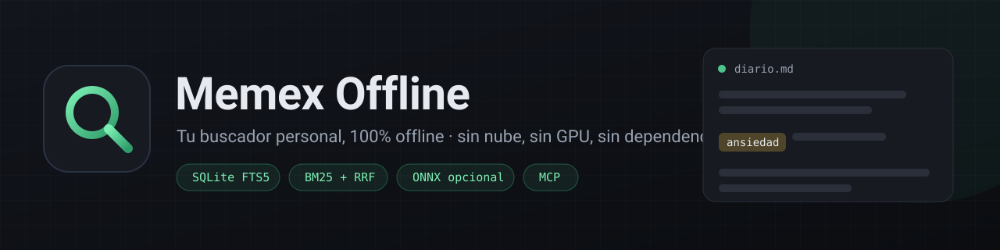
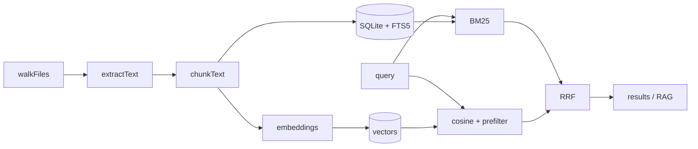

<p align="center">
  
</p>

<h1 align="center">Memex Offline</h1>

<p align="center">
  Index what you already have on disk and find it again — no cloud, no GPU, no dependencies.
</p>

<p align="center">
  <a href="https://github.com/jmarc9901/memex/actions/workflows/ci.yml"></a>
  <a href="LICENSE"></a>
  <a href="package.json">= 24" src="https://img.shields.io/badge/node-%3E%3D24-brightgreen.svg"></a>
  <a href="package.json"></a>
  
  <a href="docs/API.md"></a>
</p>

> Español: [README.md](README.md)

Memex Offline is a **personal search engine** that indexes text, notes, code,
PDFs, images (OCR), audio, video, ZIP/gzip and saved web pages. Search by exact
words (BM25), fuzzy matches or meaning with optional neural embeddings, ask
questions with **citations to your own files**, and build *trails* (associative
paths) between documents.

Everything happens on your machine: **no cloud, no telemetry, no GPU and no npm
dependencies**. The generative-AI layer is optional; the project works completely
without it.

## Contents

- [Why Memex?](#why-memex)
- [Install](#install)
- [Quick start](#quick-start)
- [Commands](#commands)
- [Web UI and API](#web-ui-and-api)
- [Browser extension](#browser-extension)
- [MCP server](#mcp-server)
- [Configuration](#configuration)
- [What it indexes](#what-it-indexes)
- [How it works](#how-it-works)
- [Tests, CI and benchmarks](#tests-ci-and-benchmarks)
- [Limitations](#limitations)
- [Privacy and security](#privacy-and-security)
- [Contributing](#contributing)
- [License](#license)

## Why Memex?

| | Memex Offline |
| --- | --- |
| **Private by design** | The index is a local SQLite file. The network is only used if you configure an LLM provider or download a model. |
| **Lightweight** | Node.js only. No `npm install`, no native modules, no GPU. |
| **Multimodal** | Text, code, PDF, OCR, audio/video, archives and saved pages. |
| **Explainable** | Every hit says whether it came from BM25, embeddings or both, with the snippet and path. |
| **Graceful degradation** | If Tesseract, ffmpeg or ONNX is missing, that feature is skipped and the rest keeps working. |
| **Open** | MIT, no telemetry and a documented threat model. |

The idea comes from **Vannevar Bush's Memex (1945)**: a personal archive you can
consult and traverse through *trails*. The cloud made it ubiquitous but
fragmented and opaque; this is the local, owned version.

## Install

One requirement: **Node.js >= 24** (uses `node:sqlite` with FTS5; verified on
Node 26). Node 22.13 **does not work**: its SQLite is built without FTS5 and the
index fails with `no such module: fts5`. There are no dependencies to install.

```bash
git clone https://github.com/jmarc9901/memex.git
cd memex
node bin/memex.js --help
```

To get the `memex` command on your `PATH`:

```bash
npm link                 # direct option
./install-cli.sh         # checks Node, syntax and tests (Linux/macOS)
install-cli.cmd          # checks Node, syntax and tests (Windows)
```

The UI has its own one-step installer (detects hardware, picks a model,
configures, indexes and writes launchers):

```bash
./install-ui.sh ~/Documents         # Linux/macOS
install-ui.cmd C:\Documents         # Windows
```

Full guide, models and troubleshooting: [docs/INSTALACION.md](docs/INSTALACION.md).

Optional, only for extra capabilities (skipped gracefully if missing):

- `pdftotext` (poppler) or `mutool` (mupdf) → PDF text.
- `tesseract` → image OCR.
- `whisper-cli` / `whisper` (+ `ffmpeg`) → audio and video transcription.
- `onnxruntime-node` + a local ONNX model → real neural semantics.

`node bin/memex.js doctor` tells you what is available.

## Quick start

```bash
# 0. One-command onboarding: model + config + index (all local)
node bin/memex.js init ~/Documents

# 1. Index a folder (incremental, and prunes deleted files)
node bin/memex.js index ~/Documents

# 2. Search by words (BM25, highlighted snippets)
node bin/memex.js search "anxiety"
node bin/memex.js search '"project x" 2024'                  # exact phrase
node bin/memex.js search "report*"                           # prefix
node bin/memex.js search "anxiety embeddings" --any          # OR instead of AND
node bin/memex.js search "how I felt" --mode semantic        # fuzzy similarity

# 3. Ask in natural language (RAG optional; shows sources without a provider)
node bin/memex.js ask "what conclusions did I reach on project X?"

# 4. Local server + web GUI
node bin/memex.js serve        # http://127.0.0.1:4747
```

`init` uses `all-MiniLM-L6-v2` (~23 MB, English) by default. For Spanish corpora,
`init --lang es` downloads the multilingual model (~180 MB) and enables real
semantics. `--no-model` stays on the `hash` provider (lexical, 256 dims) without
downloading anything. If the download fails, the project keeps working.

## Commands

| Command | Description |
| --- | --- |
| `init [folder]` | One-step onboarding: model, config and index. |
| `index [folder]` | Index or reindex incrementally. Defaults to the current folder. |
| `search <query>` | Hybrid search (lexical + semantic) with ranking. Alias: `find`. |
| `ask <question>` | RAG: local context plus a generated answer when a provider is set. |
| `export <query>` | Export results to `jsonl` (default), `csv` or `md`. |
| `relate <ref>` | Documents closest to a path or query. |
| `trails` | List existing trails. |
| `trail create/add/link/show/suggest/rm` | Create and edit associative trails. |
| `serve` | Start the local API and web GUI. |
| `mcp` | Local MCP server (stdio) for AI agents. |
| `doctor` | Diagnose tools, configuration and (`--ping`) RAG servers. |
| `models` | Models offered by detected local LLM servers. |
| `bench [folder]` | Reproducible benchmark on a throwaway index. |
| `stats` | Index statistics. |
| `clear` | Empty the index (documents, chunks, vectors and trails). |
| `embed [folder]` | Compute pending embeddings (or all with `--force`). |
| `config show\|set\|path` | Show or edit the effective configuration. |

### Common options

| Option | Description |
| --- | --- |
| `--db PATH` | Index database (default `./.memex/index.db` or `$MEMEX_DB`). |
| `--force` | Reindex everything, ignoring the mtime/size cache. |
| `--force-download` | Download the ONNX model again even if it exists. |
| `--no-prune` | Keep files that were deleted from disk in the index. |
| `--no-embed` | Index text only, without embeddings. |
| `--mode` | `hybrid` (default), `lexical` or `semantic`. |
| `-n`, `--limit` | Maximum results (1–100; default 20). |
| `--any` | Join terms with OR. |
| `--format` | `export` format (or `trail show`). |
| `-o`, `--out` | `export` output file. |
| `--host`, `--port` | `serve` host and port. Non-loopback requires `--allow-remote`. |
| `--allow-remote` | Allow listening outside localhost (the API has no authentication). |
| `--ping` | (`doctor`) Check whether local RAG servers respond. |
| `--json` | Machine-readable output. |

Full reference: [docs/CLI.md](docs/CLI.md).

## Web UI and API

`memex serve` serves a dependency-free GUI (vanilla HTML/CSS/JS) at
`http://127.0.0.1:4747`:

- **Search**: modes, OR, result limit, match highlighting and **related
  documents** for every hit.
- **Ask**: RAG answer with a list of cited sources.
- **Trails**: list, open, add nodes, view the graph as SVG and download it as DOT
  or Markdown (or copy Mermaid).
- **Index**: start indexing or index + compute vectors, with a summary that
  includes pruned files.

The API is the same one the extension consumes. Main routes:
`/api/health`, `/api/stats`, `/api/search`, `/api/relate`, `/api/trails`,
`/api/save`, `/api/ask`, `/api/index`, `/api/embed`, `/api/tools` and
`/api/config`. Full reference with examples and error codes:
[docs/API.md](docs/API.md).

## Browser extension

`extension/` contains a Chromium MV3 extension that saves the current page or
selection to your index via `POST /api/save`. It only talks to
`127.0.0.1`/`localhost`; nothing goes to the internet. Instructions in
[extension/README.md](extension/README.md).

## MCP server

`memex mcp` exposes the index as MCP tools over **stdio**, all on your machine.
Claude Desktop, Cursor, Continue or any MCP client can search your files:

```json
{
  "mcpServers": {
    "memex": { "command": "node", "args": ["/path/to/memex/bin/memex.js", "mcp"] }
  }
}
```

Tools: `memex_search`, `memex_ask`, `memex_relate`, `memex_trails`,
`memex_trail_show`, `memex_stats` and `memex_index`.

## Configuration

Precedence: **environment variables > config file > defaults**. The config file is
looked up in `$MEMEX_CONFIG`, `./.memex/config.json` and `~/.memex/config.json`,
in that order.

```json
{
  "embed_provider": "hash",
  "embed_dim": 256,
  "embed_model": "",
  "embed_tokenizer": "",
  "embed_cased": false,
  "rag": {
    "enabled": false,
    "provider": "openai-compatible",
    "base_url": "",
    "api_key": "",
    "model": ""
  },
  "server": { "host": "127.0.0.1", "port": 4747 }
}
```

`rag.provider` accepts `openai-compatible`, `groq`, `openrouter`, `gemini` and the
local presets `ollama` (`127.0.0.1:11434`), `llamacpp` (`127.0.0.1:8080`) and
`lmstudio` (`127.0.0.1:1234`). Local providers need no key. Cloudflare Workers AI
is used through `base_url` (the URL includes the `account_id`).

Variables: `MEMEX_DB`, `MEMEX_CONFIG`, `MEMEX_MODELS_DIR`,
`MEMEX_EMBED_PROVIDER`, `MEMEX_EMBED_DIM`, `MEMEX_EMBED_MODEL`,
`MEMEX_EMBED_TOKENIZER`, `MEMEX_EMBED_MAX_LEN`, `MEMEX_EMBED_CASED`,
`MEMEX_RAG_API_KEY`, `MEMEX_RAG_BASE_URL`, `MEMEX_RAG_MODEL`,
`MEMEX_RAG_PROVIDER`, `MEMEX_PORT`, `MEMEX_OCR_LANG`, `MEMEX_WHISPER_MODEL`.

### Local LLM

`memex models` detects local servers and lists their models; `memex doctor
--ping` checks whether they respond. If `rag.model` is empty, `memex ask` uses
the first available model:

```bash
ollama serve              # in another terminal
node bin/memex.js models  # -> ✓ ollama  llama3.2
node bin/memex.js ask "what conclusions did I reach?"
```

### Neural embeddings

By default embeddings are `hash` (lexical). For **real** semantics (synonyms,
paraphrases) use a local BERT model with `onnxruntime-node`:

```bash
npm install onnxruntime-node
node bin/memex.js init ~/Documents --lang es   # download and configure the model
node bin/memex.js embed ~/Documents --force    # vectorize in batches
```

If the runtime or the model is missing, you get a warning and `hash` is used. The
tokenizer preserves case and accents for *cased* models (the multilingual one)
and processes batches of 16 texts per pass. If you change provider or dimension,
recompute with `embed --force`.

## What it indexes

- **Text and notes:** `.txt`, `.md`, `.markdown`, `.rst`, `.org`, `.log`, `.csv`,
  `.tsv`, `.json`, `.jsonl`, `.yaml`, `.yml`, `.toml`, `.ini`, `.html`, `.xml`,
  `.tex`, `.srt`, `.vtt`.
- **Code:** `.js/.ts/.tsx/.py/.rb/.go/.rs/.java/.c/.cpp/.cs/.sh/.sql/.css/...`.
- **PDF:** with `pdftotext` or `mutool` if installed; otherwise skipped.
- **Images:** OCR with `tesseract` if installed.
- **Archives:** `.zip` (text/code entries) and text `.gz`, dependency-free.
- **Audio/video:** transcription with `whisper.cpp` or Python `whisper`.
- **Web:** pages saved from the extension (`source: "extension"`).

Binaries, folders such as `.git`, `node_modules`, `dist`, `build`, `__pycache__`,
`.venv`, and files over 25 MB are ignored.

## How it works

1. `walkFiles` walks the folder (and fails with a clear message if the path does
   not exist), filtering by extension and ignore rules.
2. `extractText` reads each file and `chunkText` splits it into ~1600-character
   chunks that respect paragraphs.
3. Each chunk goes into `chunks` and the virtual FTS5 table `chunks_fts`
   (`unicode61 remove_diacritics 2`: *cancion* finds *Canción*).
4. Embeddings are stored as BLOBs and loaded into an in-memory matrix with a
   binary prefilter (popcount) before the exact cosine.
5. `hybridSearch` combines BM25 and cosine similarity with **Reciprocal Rank
   Fusion**.
6. `ask` retrieves the most relevant chunks and builds a prompt with citations.
7. Indexing is **incremental** (size + mtime): unchanged files are skipped and
   files deleted from disk are **removed from the index** under that folder
   (`--no-prune` disables it).



Module details, data model and invariants: [docs/ARQUITECTURA.md](docs/ARQUITECTURA.md).

## Tests, CI and benchmarks

```bash
npm run check      # syntax of every .js (no dependencies)
npm test           # 144 tests with node --test
npm run coverage   # built-in node --test coverage
npm run bench      # indexing and search benchmark
```

The suite covers query parsing, chunking, incremental indexing and **pruning**,
lexical/semantic search, RRF fusion, embeddings (including batching), the vector
cache, trails, offline and provider-backed RAG, the HTTP API, the MCP server, the
installers, the browser extension and the GUI helpers. `test/quality.test.js`
measures **precision@1 / recall@3** on a labelled corpus: it catches ranking
regressions, not just "search returned something".

CI: Linux/Windows/macOS × Node 24/26 matrix, `npm ci`, `check`, `test`, coverage
on Linux/26 and a package check (assets, docs, icons and aligned versions). No
dependencies: the only "packages" are the workflow actions.

```bash
node bin/memex.js bench ~/Documents          # files/s, latency and RSS
node bin/memex.js bench ~/Documents --json
```

`bench` indexes into a temporary database (never your real index) and removes it
on exit.

## Limitations

- **"Semantic" search is lexical by default.** With no configuration, vectors use
  *feature hashing* (typo-tolerant lexical overlap), not meaning: a paraphrase
  with no shared words will not appear. For real semantics, enable `onnx`
  (optional, requires the runtime and a local model).
- **Scanned PDFs without a text layer:** there is no rasterize + OCR pipeline;
  they are skipped if `pdftotext`/`mutool` extract nothing.
- **Personal scale.** The in-memory semantic index and binary prefilter work well
  for tens or hundreds of thousands of chunks, not millions.
- **The index is not encrypted.** It is a local SQLite file; protect the folder
  with OS permissions.
- **Indexing is single-process.** The server yields between files, but one huge
  file (or slow OCR) blocks while it is processed.
- **Heavy multilingual model:** ~180 MB vs 23 MB for the English MiniLM. On
  modest machines, `--no-model` or `--quality speed` keep onboarding light;
  lexical search still works.

## Privacy and security

- The server listens on **loopback only** by default. A non-local `--host`
  without `--allow-remote` is rejected at startup, because the API has no
  authentication.
- The API rejects requests whose `Origin` is not `localhost`/`127.0.0.1` or a
  browser extension: a website you visit cannot read or write your index.
  Responses are never cached (`cache-control: no-store`).
- The GUI sends `Content-Security-Policy` (no external resources, no inline
  scripts), `X-Content-Type-Options: nosniff`, `X-Frame-Options: DENY` and
  `Referrer-Policy: no-referrer`; static files are confined to `web/`.
- No cloud, no telemetry. The only network traffic is to the LLM provider you
  configure (optional) and the model download during `init`.
- Threat model and private reporting: [SECURITY.md](SECURITY.md).

## Contributing

The zero rule is **no dependencies**: Node's standard library only. Before a PR:
`npm run check`, `npm test` and, if you touch ranking, look at
`test/quality.test.js`. Full guide in [CONTRIBUTING.md](CONTRIBUTING.md); code of
conduct in [CODE_OF_CONDUCT.md](CODE_OF_CONDUCT.md).

Documentation:

- [docs/CLI.md](docs/CLI.md) — commands and options reference.
- [docs/API.md](docs/API.md) — local HTTP API, parameters and errors.
- [docs/ARQUITECTURA.md](docs/ARQUITECTURA.md) — modules, data and invariants.
- [docs/INSTALACION.md](docs/INSTALACION.md) — installation, models, troubleshooting.
- [docs/PROBAR-UI.md](docs/PROBAR-UI.md) — manual UI and API walkthrough.
- [docs/ROADMAP.md](docs/ROADMAP.md) — vision, phases and AI routes.
- [CHANGELOG.md](CHANGELOG.md) — what changed in each version.

## License

MIT. See [LICENSE](LICENSE).
