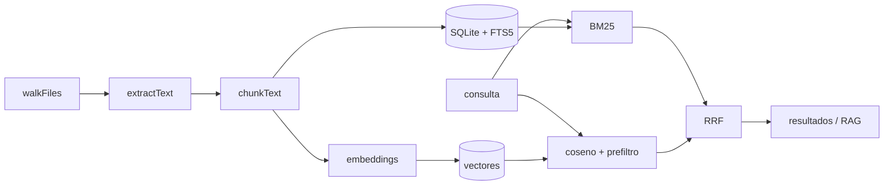

<p align="center">
  
</p>

<h1 align="center">Memex Offline</h1>

<p align="center">
  Indexa lo que ya tienes en el disco y encuéntralo sin nube, sin GPU y sin dependencias.
</p>

<p align="center">
  <a href="https://github.com/jmarc9901/memex/actions/workflows/ci.yml"></a>
  <a href="LICENSE"></a>
  <a href="package.json">= 24" src="https://img.shields.io/badge/node-%3E%3D24-brightgreen.svg"></a>
  <a href="package.json"></a>
  
  <a href="docs/API.md"></a>
</p>

> English: [README.en.md](README.en.md)

Memex Offline es un **buscador personal** que indexa texto, notas, código, PDFs,
imágenes (OCR), audio, vídeo, ZIP/gzip y páginas web guardadas. Busca por palabras
exactas (BM25), por coincidencia difusa o por significado con embeddings
neuronales opcionales, responde preguntas con **citas a tus archivos** y crea
*trails* (caminos asociativos) entre documentos.

Todo ocurre en tu máquina: **sin nube, sin telemetría, sin GPU y sin dependencias
npm**. La capa de IA generativa es opcional; el proyecto funciona por completo sin
ella.

## Índice

- [¿Por qué Memex?](#por-qué-memex)
- [Instalación](#instalación)
- [Uso rápido](#uso-rápido)
- [Comandos](#comandos)
- [Interfaz web y API](#interfaz-web-y-api)
- [Extensión de navegador](#extensión-de-navegador)
- [Servidor MCP](#servidor-mcp)
- [Configuración](#configuración)
- [Qué indexa](#qué-indexa)
- [Cómo funciona](#cómo-funciona)
- [Tests, CI y benchmarks](#tests-ci-y-benchmarks)
- [Limitaciones](#limitaciones)
- [Privacidad y seguridad](#privacidad-y-seguridad)
- [Contribuir](#contribuir)
- [Licencia](#licencia)

## ¿Por qué Memex?

| | Memex Offline |
| --- | --- |
| **Privado por diseño** | El índice vive en un SQLite local. La red solo se usa si configuras un proveedor RAG o descargas un modelo. |
| **Ligero** | Solo Node.js. Sin `npm install`, sin nativos, sin GPU. |
| **Multimodal** | Texto, código, PDF, OCR, audio/vídeo, comprimidos y webs guardadas. |
| **Explicable** | Cada resultado dice si vino de BM25, de embeddings o de ambos, con el fragmento y la ruta. |
| **Degrada con gracia** | Si falta Tesseract, ffmpeg u ONNX, esa capacidad se omite y el resto sigue. |
| **Abierto** | MIT, sin telemetría y con un modelo de amenazas documentado. |

La idea viene del **Memex de Vannevar Bush (1945)**: un archivo personal donde uno
puede consultar todo lo que sabe y recorrer *trails* entre documentos. La nube lo
hizo ubicuo, pero fragmentado y opaco; esto es la versión local y tuya.

## Instalación

Requisito único: **Node.js >= 24** (usa `node:sqlite` con FTS5; verificado con
Node 26). Node 22.13 **no** sirve: su SQLite no compila FTS5 y el índice falla con
`no such module: fts5`. No hay dependencias que instalar.

```bash
git clone https://github.com/jmarc9901/memex.git
cd memex
node bin/memex.js --help
```

Para tener el comando `memex` en el `PATH`:

```bash
npm link                 # opción directa
./install-cli.sh         # instalador con comprobaciones (Linux/macOS)
install-cli.cmd          # instalador con comprobaciones (Windows)
```

La UI tiene su propio instalador en un paso (detecta hardware, elige modelo,
configura, indexa y crea lanzadores):

```bash
./install-ui.sh ~/Documentos         # Linux/macOS
install-ui.cmd C:\Documentos         # Windows
```

Guía completa, modelos y resolución de problemas: [docs/INSTALACION.md](docs/INSTALACION.md).

Opcional, solo para capacidades extra (si no están, se omiten sin fallar):

- `pdftotext` (poppler) o `mutool` (mupdf) → texto de PDFs.
- `tesseract` → OCR de imágenes.
- `whisper-cli` / `whisper` (+ `ffmpeg`) → transcripción de audio y vídeo.
- `onnxruntime-node` + un modelo ONNX local → semántica neuronal real.

`node bin/memex.js doctor` te dice qué tienes.

## Uso rápido

```bash
# 0. Onboarding en un comando: modelo + config + índice (todo local)
node bin/memex.js init ~/Documentos

# 1. Indexar una carpeta (incremental y con poda de borrados)
node bin/memex.js index ~/Documentos

# 2. Buscar por palabras (BM25, fragmentos resaltados)
node bin/memex.js search "ansiedad"
node bin/memex.js search '"proyecto x" 2024'                 # frase exacta
node bin/memex.js search "informe*"                          # prefijo
node bin/memex.js search "ansiedad embeddings" --any         # OR en vez de AND
node bin/memex.js search "como me sentia" --mode semantic    # similitud difusa

# 3. Preguntar en lenguaje natural (RAG opcional; sin config muestra fuentes)
node bin/memex.js ask "¿qué conclusiones saqué del proyecto X?"

# 4. Servidor local + GUI web
node bin/memex.js serve        # http://127.0.0.1:4747
```

`init` usa por defecto `all-MiniLM-L6-v2` (~23 MB, inglés). Para corpus en
español, `init --lang es` descarga el modelo multilingüe (~180 MB) y activa
semántica real. `--no-model` se queda en el proveedor `hash` (léxico, 256 dims)
sin descargar nada. Si la descarga falla, el proyecto sigue funcionando.

## Comandos

| Comando | Descripción |
| --- | --- |
| `init [carpeta]` | Onboarding en un paso: modelo, config e índice. |
| `index [carpeta]` | Indexa o reindexa de forma incremental. Por defecto, la carpeta actual. |
| `search <consulta>` | Búsqueda híbrida (léxica + semántica) con ranking. Alias: `find`. |
| `ask <pregunta>` | RAG: recupera contexto local y, si hay proveedor, genera respuesta. |
| `export <consulta>` | Exporta resultados a `jsonl` (defecto), `csv` o `md`. |
| `relate <ref>` | Documentos más parecidos a una ruta o consulta. |
| `trails` | Lista los trails existentes. |
| `trail create/add/link/show/suggest/rm` | Crea y edita trails asociativos. |
| `serve` | Arranca la API local y la GUI web. |
| `mcp` | Servidor MCP local (stdio) para agentes de IA. |
| `doctor` | Diagnóstico: herramientas, configuración y (`--ping`) servidores RAG. |
| `models` | Modelos ofrecidos por los LLM locales detectados. |
| `bench [carpeta]` | Benchmark reproducible sobre un índice desechable. |
| `stats` | Estadísticas del índice. |
| `clear` | Vacía el índice (documentos, chunks, vectores y trails). |
| `embed [carpeta]` | Calcula los embeddings pendientes (o todos con `--force`). |
| `config show\|set\|path` | Muestra o edita la configuración efectiva. |

### Opciones comunes

| Opción | Descripción |
| --- | --- |
| `--db RUTA` | Base de datos del índice (defecto `./.memex/index.db` o `$MEMEX_DB`). |
| `--force` | Reindexa todo ignorando la caché por fecha/tamaño. |
| `--force-download` | Vuelve a descargar el modelo ONNX aunque ya exista. |
| `--no-prune` | No elimina del índice los archivos borrados del disco. |
| `--no-embed` | Indexa solo texto, sin calcular embeddings. |
| `--mode` | `hybrid` (defecto), `lexical` o `semantic`. |
| `-n`, `--limit` | Máximo de resultados (1–100; defecto 20). |
| `--any` | Une los términos con OR. |
| `--format` | Formato de `export` (o de `trail show`). |
| `-o`, `--out` | Archivo de salida de `export`. |
| `--host`, `--port` | Host y puerto de `serve`. Fuera de loopback exige `--allow-remote`. |
| `--allow-remote` | Permite escuchar fuera de `localhost` (la API no tiene autenticación). |
| `--ping` | (`doctor`) Comprueba si los servidores RAG locales responden. |
| `--json` | Salida en JSON para scripts. |

Referencia completa: [docs/CLI.md](docs/CLI.md).

## Interfaz web y API

`memex serve` sirve una GUI sin dependencias (HTML/CSS/JS vanilla) en
`http://127.0.0.1:4747`:

- **Buscar**: modos, OR, límite, resaltado de coincidencias y **documentos
  relacionados** de cada resultado.
- **Preguntar**: respuesta RAG con lista de fuentes citadas.
- **Trails**: listar, abrir, añadir nodos, ver el grafo en SVG y descargarlo en
  DOT o Markdown (o copiar Mermaid).
- **Indexar**: lanzar el indexado o indexar + calcular vectores, con el resumen
  (incluidos los archivos eliminados).

La API es la misma que consume la extensión. Rutas principales:
`/api/health`, `/api/stats`, `/api/search`, `/api/relate`, `/api/trails`,
`/api/save`, `/api/ask`, `/api/index`, `/api/embed`, `/api/tools` y
`/api/config`. Referencia completa con ejemplos y códigos de error:
[docs/API.md](docs/API.md).

## Extensión de navegador

En `extension/` hay una extensión Chromium (MV3) que guarda la página actual o la
selección en tu índice vía `POST /api/save`. Solo habla con
`127.0.0.1`/`localhost`; no envía nada a internet. Instrucciones en
[extension/README.md](extension/README.md).

## Servidor MCP

`memex mcp` expone el índice como herramientas MCP por **stdio**, todo en tu
máquina. Claude Desktop, Cursor, Continue o cualquier cliente MCP pueden buscar
en tus archivos:

```json
{
  "mcpServers": {
    "memex": { "command": "node", "args": ["/ruta/a/memex/bin/memex.js", "mcp"] }
  }
}
```

Herramientas: `memex_search`, `memex_ask`, `memex_relate`, `memex_trails`,
`memex_trail_show`, `memex_stats` y `memex_index`.

## Configuración

Precedencia: **variables de entorno > archivo de config > valores por defecto**.
El archivo se busca, por orden, en `$MEMEX_CONFIG`, `./.memex/config.json` y
`~/.memex/config.json`.

```json
{
  "embed_provider": "hash",
  "embed_dim": 256,
  "embed_model": "",
  "embed_tokenizer": "",
  "embed_cased": false,
  "rag": {
    "enabled": false,
    "provider": "openai-compatible",
    "base_url": "",
    "api_key": "",
    "model": ""
  },
  "server": { "host": "127.0.0.1", "port": 4747 }
}
```

`rag.provider` acepta `openai-compatible`, `groq`, `openrouter`, `gemini` y los
presets locales `ollama` (`127.0.0.1:11434`), `llamacpp` (`127.0.0.1:8080`) y
`lmstudio` (`127.0.0.1:1234`). Los proveedores locales no necesitan clave.
Cloudflare Workers AI se usa vía `base_url` (la URL incluye el `account_id`).

Variables: `MEMEX_DB`, `MEMEX_CONFIG`, `MEMEX_MODELS_DIR`,
`MEMEX_EMBED_PROVIDER`, `MEMEX_EMBED_DIM`, `MEMEX_EMBED_MODEL`,
`MEMEX_EMBED_TOKENIZER`, `MEMEX_EMBED_MAX_LEN`, `MEMEX_EMBED_CASED`,
`MEMEX_RAG_API_KEY`, `MEMEX_RAG_BASE_URL`, `MEMEX_RAG_MODEL`,
`MEMEX_RAG_PROVIDER`, `MEMEX_PORT`, `MEMEX_OCR_LANG`, `MEMEX_WHISPER_MODEL`.

### LLM local

`memex models` detecta servidores locales y lista sus modelos; `memex doctor
--ping` comprueba si responden. Si no configuras `rag.model`, `memex ask` usa el
primer modelo disponible:

```bash
ollama serve              # en otra terminal
node bin/memex.js models  # -> ✓ ollama  llama3.2
node bin/memex.js ask "¿qué conclusiones saqué?"
```

### Embeddings neuronales

Por defecto los embeddings son `hash` (léxicos). Para semántica **real**
(sinónimos, paráfrasis) usa un modelo BERT local con `onnxruntime-node`:

```bash
npm install onnxruntime-node
node bin/memex.js init ~/Documentos --lang es   # descarga y configura el modelo
node bin/memex.js embed ~/Documentos --force    # vectoriza por lotes
```

Si falta el runtime o el modelo, se avisa y se usa `hash` sin fallar. El tokenizer
respeta mayúsculas y acentos cuando el modelo es *cased* (el multilingüe) y
procesa lotes de 16 textos por pasada. Si cambias de proveedor o de dimensión,
recalcula con `embed --force`.

## Qué indexa

- **Texto y notas:** `.txt`, `.md`, `.markdown`, `.rst`, `.org`, `.log`, `.csv`,
  `.tsv`, `.json`, `.jsonl`, `.yaml`, `.yml`, `.toml`, `.ini`, `.html`, `.xml`,
  `.tex`, `.srt`, `.vtt`.
- **Código:** `.js/.ts/.tsx/.py/.rb/.go/.rs/.java/.c/.cpp/.cs/.sh/.sql/.css/...`.
- **PDF:** con `pdftotext` o `mutool` si están instalados; si no, se omiten.
- **Imágenes:** OCR con `tesseract` si está instalado.
- **Comprimidos:** `.zip` (se indexan sus entradas de texto/código) y `.gz` de
  texto, sin dependencias.
- **Audio/vídeo:** transcripción con `whisper.cpp` o `whisper` de Python.
- **Web:** páginas guardadas desde la extensión (`source: "extension"`).

Se ignoran binarios, carpetas como `.git`, `node_modules`, `dist`, `build`,
`__pycache__`, `.venv`, etc., y archivos de más de 25 MB.

## Cómo funciona

1. `walkFiles` recorre la carpeta (y falla con un mensaje claro si la ruta no
   existe) y filtra por extensión y reglas de ignorado.
2. `extractText` lee cada archivo y `chunkText` lo trocea en fragmentos de ~1600
   caracteres respetando párrafos.
3. Cada fragmento va a `chunks` y a la tabla virtual FTS5 `chunks_fts`
   (`unicode61 remove_diacritics 2`: *cancion* encuentra *Canción*).
4. Los embeddings se guardan como BLOB y se indexan en memoria con un prefiltro
   binario (popcount) antes del coseno exacto.
5. `hybridSearch` combina BM25 y similitud coseno con **Reciprocal Rank Fusion**.
6. `ask` recupera los fragmentos más relevantes y construye un prompt con citas.
7. El indexado es **incremental** (tamaño + mtime): no reprocesa lo que no cambió
   y **elimina del índice los archivos que ya no existen** bajo esa carpeta
   (`--no-prune` lo desactiva).



Detalle de módulos, modelo de datos e invariantes: [docs/ARQUITECTURA.md](docs/ARQUITECTURA.md).

## Tests, CI y benchmarks

```bash
npm run check      # sintaxis de todos los .js (sin dependencias)
npm test           # 144 pruebas con node --test
npm run coverage   # cobertura integrada de node --test
npm run bench      # benchmark de indexado y búsqueda
```

La suite cubre parseo de consultas, chunking, indexado incremental y **poda**,
búsqueda léxica/semántica, fusión RRF, embeddings (incluido batching), caché
vectorial, trails, RAG offline y con proveedor simulado, la API HTTP, el servidor
MCP, los instaladores, la extensión y los helpers de la GUI. `test/quality.test.js`
mide **precision@1 / recall@3** sobre un corpus etiquetado: es la red que detecta
regresiones de ranking, no solo que la búsqueda devuelva algo.

CI: matriz Linux/Windows/macOS × Node 24/26, `npm ci`, `check`, `test`, cobertura
en Linux/26 y verificación del paquete (assets, docs, iconos y versión alineada).
Sin dependencias: los únicos "paquetes" son las acciones del workflow.

```bash
node bin/memex.js bench ~/Documentos          # archivos/s, latencia y RSS
node bin/memex.js bench ~/Documentos --json
```

`bench` indexa en un índice temporal (no toca el real) y lo borra al salir.

## Limitaciones

- **La búsqueda "semántica" es léxica por defecto.** Sin configurar nada, los
  vectores usan *feature hashing* (solapamiento léxico tolerante a erratas), no
  significado: una paráfrasis sin palabras en común no aparecerá. Para semántica
  real, activa `onnx` (opcional, requiere runtime y modelo local).
- **PDF escaneado sin capa de texto:** no hay rasterizado + OCR de páginas; se
  omiten si `pdftotext`/`mutool` no extraen texto.
- **Escala personal.** El índice semántico en memoria y el prefiltro binario van
  bien con decenas o cientos de miles de fragmentos, no con millones.
- **El índice no está cifrado.** Es SQLite local; protege la carpeta con los
  permisos del sistema.
- **El indexado es single-process.** El servidor cede el event loop entre
  archivos, pero un archivo enorme (o un OCR lento) bloquea mientras se procesa.
- **Modelo multilingüe pesado:** ~180 MB frente a los 23 MB del MiniLM inglés.
  En equipos modestos, `--no-model` o `--quality speed` mantienen el onboarding
  ligero; la búsqueda léxica sigue funcionando.

## Privacidad y seguridad

- El servidor escucha **solo en loopback** por defecto. Un `--host` no local sin
  `--allow-remote` se rechaza al arrancar, porque la API no tiene autenticación.
- La API rechaza peticiones con un `Origin` que no sea de `localhost`/`127.0.0.1`
  ni de una extensión de navegador: una web que visites no puede leer ni escribir
  tu índice. Las respuestas no se cachean (`cache-control: no-store`).
- La GUI lleva `Content-Security-Policy` (sin recursos externos ni scripts
  inline), `X-Content-Type-Options: nosniff`, `X-Frame-Options: DENY` y
  `Referrer-Policy: no-referrer`; los estáticos están confinados a `web/`.
- Sin nube y sin telemetría. El único tráfico de red es hacia el proveedor RAG
  que configures (opcional) y la descarga del modelo en `init`.
- Modelo de amenazas y reporte privado: [SECURITY.md](SECURITY.md).

## Contribuir

La regla cero es **sin dependencias**: solo biblioteca estándar de Node. Antes de
un PR: `npm run check`, `npm test` y, si tocas el ranking, mira
`test/quality.test.js`. Guía completa en [CONTRIBUTING.md](CONTRIBUTING.md);
código de conducta en [CODE_OF_CONDUCT.md](CODE_OF_CONDUCT.md).

Documentación:

- [docs/CLI.md](docs/CLI.md) — referencia de comandos y opciones.
- [docs/API.md](docs/API.md) — API HTTP local, parámetros y errores.
- [docs/ARQUITECTURA.md](docs/ARQUITECTURA.md) — módulos, datos e invariantes.
- [docs/INSTALACION.md](docs/INSTALACION.md) — instalación, modelos y problemas.
- [docs/PROBAR-UI.md](docs/PROBAR-UI.md) — prueba manual de la UI y la API.
- [docs/ROADMAP.md](docs/ROADMAP.md) — visión, fases y rutas de IA.
- [CHANGELOG.md](CHANGELOG.md) — qué cambió en cada versión.

## Licencia

MIT. Ver [LICENSE](LICENSE).
