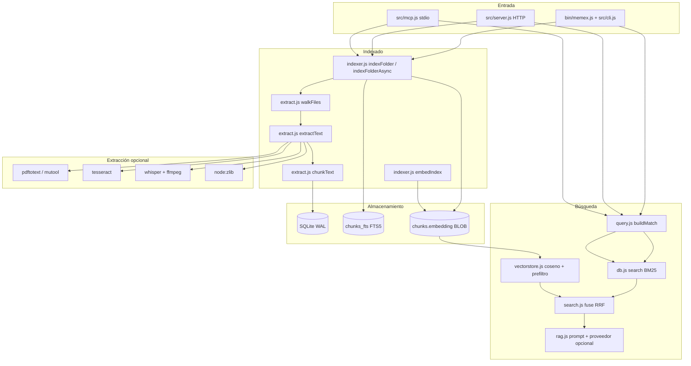

# Arquitectura

Memex Offline es una herramienta **local y mono-proceso**. No hay servicios, ni
colas, ni base de datos externa: un SQLite (`node:sqlite`) y módulos ES de la
biblioteca estándar. Este documento explica cómo encajan y qué invariantes hay
que respetar al tocarlo.

## Vista general



## Responsabilidades

| Módulo | Responsabilidad | No debe hacer |
| --- | --- | --- |
| `bin/memex.js` | Comprobar Node y arrancar el CLI | Importar nada antes de la guardia de versión |
| `src/cli.js` | Parsear argumentos, formatear salida | Lógica de indexado o SQL |
| `src/init.js` | Onboarding: modelo + config + primer índice | Buscar o servir |
| `src/config.js` | Defaults, archivo y entorno | Escribir el índice |
| `src/extract.js` | Recorrer, extraer, trocear | Tocar SQLite |
| `src/archive.js` | Leer ZIP/gzip con `node:zlib` | Interpretar el contenido |
| `src/indexer.js` | Orquestar altas/bajas, transacciones, embeddings | Formatear para el usuario |
| `src/db.js` | Esquema, consultas, trails | Decidir ranking |
| `src/query.js` | Convertir lenguaje natural en `MATCH` | Ejecutar la consulta |
| `src/search.js` | Ranking híbrido y fusión RRF | Leer archivos del disco |
| `src/vectorstore.js` | Caché matricial y similitud | Persistir nada |
| `src/rag.js` | Recuperar contexto y generar (opcional) | Indexar |
| `src/trails.js` | Grafos asociativos y exportaciones | Buscar en FTS |
| `src/server.js` | API + estáticos + seguridad | Indexar en otro hilo |
| `src/mcp.js` | JSON-RPC por stdio | Escribir en stdout otra cosa |
| `src/doctor.js` | Diagnosticar binarios y config | Instalar nada |

## Modelo de datos

```
files(id, path UNIQUE, name, ext, size, mtime, sha256, chunks, status,
      source, url, title, indexed_at)
chunks(id, file_id → files ON DELETE CASCADE, chunk_index, content,
       embedding BLOB, embed_dim)
chunks_fts(content)            -- FTS5, rowid = chunks.id, unicode61 sin diacríticos
meta(key, value)               -- embed_provider, embed_dim
trails(id, name UNIQUE, description, created_at, updated_at)
trail_nodes(id, trail_id → trails, file_id → files, note, position)
trail_edges(id, trail_id → trails, from_file → files, to_file → files, label)
```

`PRAGMA journal_mode = WAL` y `foreign_keys = ON`. Los borrados en cascada
mantienen chunks y nodos coherentes; `chunks_fts` se borra explícitamente porque
las tablas virtuales de FTS5 no participan en las claves foráneas.

## Invariantes

1. **Reindexado atómico por archivo.** Borrar+insertar ocurre dentro de
   `withTransaction`; si falla, el documento anterior sigue consultable.
2. **Poda acotada a la raíz.** `pruneMissing` solo elimina rutas cuyo prefijo es
   la carpeta indexada. Indexar `~/A` nunca borra `~/B` de la misma base.
3. **La caché vectorial se invalida siempre** tras indexar, vectorizar o guardar
   (`resetStore`), y también cuando otra conexión escribe (`PRAGMA data_version`).
4. **Un solo proveedor de embeddings por índice.** Mezclar dimensiones no se
   trunca: se avisa (`MEMEX_EMBED_DIM_MISMATCH`) y se descarta la rama semántica.
5. **La generación es opcional.** Sin proveedor configurado, `ask` devuelve
   contexto local y `offline: true`; nunca falla por falta de red.
6. **La API vive en loopback.** Fuera de loopback exige `--allow-remote`, porque
   no hay autenticación.
7. **El CLI no mezcla avisos con stdout.** Los avisos van a stderr para no romper
   `--json`.

## Ciclo de indexado

```
walkFiles(root) ──► por archivo:
   statSync ──► ¿mtime+size iguales y no --force? ──► unchanged
   extractText ──► null (binario/herramienta ausente) ──► unsupported (y borra si existía)
   chunkText ──► ~1600 caracteres, 200 de solape ──► chunks
   embedder síncrono (hash) ──► vectores en la misma transacción
   insertFile ──► files + chunks + chunks_fts
fin ──► pruneMissing(root, vistos) ──► resetStore
```

Con ONNX el indexado escribe solo texto y `memex embed` (o `POST /api/embed`)
calcula los vectores en lotes de 16. El servidor usa `indexFolderAsync`, que cede
el event loop entre archivos: una carpeta grande ya no congela la GUI.

## Búsqueda

1. `buildMatch` escapa a FTS5: frases entrecomilladas, prefijos `*`, AND u OR.
2. Léxica: `bm25(chunks_fts)` ascendente (más negativo = mejor) y `snippet`.
3. Semántica: vector de consulta → matriz en memoria → prefiltro binario
   (popcount de signos) → coseno exacto del shortlist → umbral por proveedor.
4. Fusión: RRF `1/(60+rank)` con pesos; el snippet léxico gana si existe.
5. `ask`: los mismos hits se numeran y se envían como contexto `[n]`.

## Rendimiento

- El corpus objetivo es personal: decenas o cientos de miles de fragmentos.
- `EXACT_LIMIT = 4096`: por debajo se escanea exacto; por encima, prefiltro
  binario con shortlist de al menos 512.
- `memex bench` mide en un índice temporal: archivos/s, mediana de latencia y RSS.
- El coste dominante con ONNX es la inferencia; de ahí el batching.

## Seguridad

Ver [SECURITY.md](../SECURITY.md). En corto: loopback por defecto, CORS solo para
localhost y extensiones, CSP sin recursos externos, estáticos confinados a
`web/`, SQL parametrizado y procesos externos sin shell.
